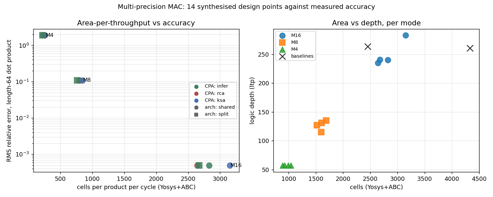

# Design-space exploration, number formats, and a rewrite that needs a side-condition

Phase 2. Three things that Phase 1 pointed at but did not do: sweep the variant
space automatically, put an accuracy axis next to the area axis, and build a
concrete case where an algebraic identity is only valid under a bitwidth
condition.

```bash
./dse.sh                                   # 14 synthesised points -> results/dse.csv
python3 model/formats.py                   # accuracy study
cd results && python3 plot_dse.py          # the Pareto
cd formal && sby -f dist_wide.sby          # PASS
                sby -f dist_narrow.sby     # FAIL, with a counterexample
                sby -f dist_cond.sby       # PASS under the side-condition
```

## A rewrite that is only valid under a bitwidth condition

`a*b + a*c → a*(b+c)` is true over the integers and false in hardware, because
the intermediate `b+c` has a width. This is the concrete form of the
"sufficient condition" column in Coward, Constantinides & Drane (ARITH 2022,
Table II), where every rewrite carries a bitwidth side-condition for exactly
this reason.

Three circuits computing the same integer expression, `rtl/distribute.v`:

| module | intermediate | result |
|---|---|---|
| `dist_expanded` | none — two multiplies | reference |
| `dist_wide` | `b+c` in W+1 bits | **proved equal, unconditionally** |
| `dist_narrow` | `b+c` truncated to W bits | **proved unequal** |
| `dist_narrow` + assumption | same circuit, `b+c` constrained not to overflow | **proved equal** |

The counterexample the solver returns for the narrow case, at W=4:

```
a = 1,  b = 12,  c = 4
a*b + a*c        = 16
b + c            = 16  ->  truncated to 4 bits = 0
a * ((b+c) mod 16) = 0
```

One input triple out of 4096. The narrow circuit is the *cheaper* one, which is
the whole problem: a rewriter that applies the identity unconditionally produces
a smaller design that is wrong on a subset of inputs no directed test is likely
to visit. The condition is not a footnote on the rewrite — it is the rewrite.

Worth recording: the same proof at **W=8 did not close in ten minutes**, while
W=4 closes instantly. Multiplier equivalence is the classic hard case for
bit-blasting SMT, and it is why the equivalence work elsewhere in this
repository is careful to pick the smallest block that carries the obligation.

## Design-space exploration

`dse.sh` generates and synthesises the cross product of architecture ×
carry-propagate structure × precision mode, locking `mode` to a constant so each
point is specialised to one lane width. 14 points, `results/dse.csv`.



Cheapest point per mode, measured as **cells per product per cycle** — narrow
modes buy lanes, so raw cell count hides half the trade:

| mode | best variant | cells/product | RMS relative error |
|---|---|---|---|
| `M16` | shared / rca | 2641.0 | 4.91e-04 |
| `M8`  | split / infer | 761.5 | 1.08e-01 |
| `M4`  | split / infer | 223.0 | 1.88e+00 |

**`M4` is 12× cheaper per product than `M16` and 3800× less accurate.** On a
general length-64 dot product a 4-bit lane produces a 188% RMS error, which is
not a usable answer at any price. `M8` is 3.5× cheaper for a 10.8% error.

So the Pareto is real but steep, and the useful conclusion is a conditional one:
the narrow modes only pay for themselves in an application that can absorb that
error. That is precisely the premise of error-tolerant design-space exploration
— the ARITH 2020 line of work — though that paper is paywalled here and this
note relates to the *idea*, not to its contents.

## Number formats at a fixed width

`model/formats.py`. Posit values are obtained by decoding all 2^16 bit patterns
and quantising to the nearest, which is obviously correct and cheap; the decoder
is checked against `maxpos = useed^(n-2) = 4^14 = 2^28`.

RMS relative error on the same length-64 dot product:

| format | uniform [-1,1) | wide, 8 decades |
|---|---|---|
| fixed Q1.15 | **4.91e-04** | 1.00e+00 |
| IEEE binary16 | 3.84e-03 | **2.09e-02** |
| posit(16,1) | 1.20e-03 | 1.96e-01 |

**The ranking inverts, and posit is second in both columns.** Fixed point wins
where the range is known and bounded — and fails outright where it is not.
Posit(16,1) beats binary16 by 3× near 1, where its tapered accuracy spends bits
on the fraction. Binary16 beats posit by 9× across 8 decades, because out at the
extremes the regime field has eaten the bits the fraction needed.

Tapered accuracy is a bet that the data sits near 1, not a free win. That is the
useful thing to be able to say about posits, and it is close to the opposite of
how they are usually pitched.

**No area number belongs beside this table.** There is no float or posit RTL
here, and inventing a cost model to fill the column would be worse than leaving
it empty. Only the fixed-point row has hardware behind it, and that hardware is
in `results/dse.csv`.

## Limits

- The accuracy study quantises the *inputs* and accumulates in double. Real
  hardware also quantises the accumulator, which the 48-bit lane file makes a
  small effect here but not a zero one.
- Two workloads is not a survey. The point is that the ranking depends on the
  distribution, not that these two distributions are representative.
- `dse.sh` explores a space someone hand-wrote. It does not *generate*
  architectures — the rewriting-based approaches this note cites do, and that
  gap is the interesting one.
